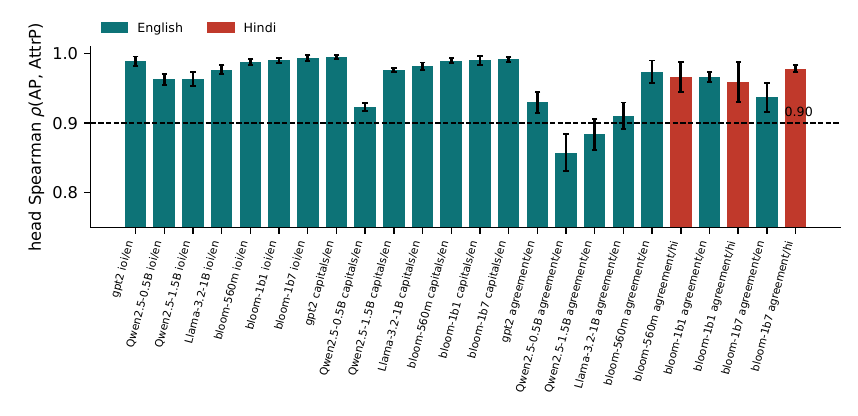

# When does attribution patching agree with activation patching?

Mini-project for CL3.412 *Mechanistic Interpretability of Language Models* (IIIT Hyderabad), Hrishiraj Mitra (2023111037).

**Question.** Activation patching (AP) is the standard causal test for which heads and MLPs a model uses, but it costs one forward pass per component. Attribution patching (AttrP) replaces those passes with one gradient. Where does it rank components the way AP does, and where does it break, once the task, the language (English / Hindi) and the model change?

**Short answer** (440 runs; 9 models of at most 2B parameters; 4 tasks; both patching directions; 5 prompt seeds):

- A competence gate runs first. Of 66 (model, task, language) cells, 43 pass strictly and 22 fail. Every Hindi IOI cell fails: the models cannot do the task.
- Where the comparison can be run, AttrP reproduces the AP **head** ranking in 22 of 24 core cells (Spearman rho >= 0.90), at about 1/49 of the cost.
- On the one task where Hindi can be tested well (agreement, BLOOM family), Hindi agrees as well as English, within +/-0.05. One task, one family, three pairs.
- AttrP fails on **MLP** outputs of IOI-type circuits, concentrated in MLP layer 0.
- Node-level integrated gradients (EAP-IG) repairs layer 0 on GPT-2 IOI but lowers head agreement by 0.36 on average, at about 3.5x the cost of AttrP. Not a free upgrade.



## Where to look

| What | Where |
|---|---|
| Final report | [report.pdf](report.pdf) (source: [report/report.tex](report/report.tex)) |
| Talk slides, speaker notes | [slides/results/results_deck.pdf](slides/results/results_deck.pdf), [.pptx](slides/results/results_deck.pptx), [speaker_notes.md](slides/results/speaker_notes.md) |
| Protocol, fixed before the grid | [PREREGISTRATION_v2.md](PREREGISTRATION_v2.md) (with amendments), pilot: [PREREGISTRATION.md](PREREGISTRATION.md) |
| Working write-up (pilot + extension) | [WRITEUP.md](WRITEUP.md) |
| Full analysis tables | [results/analysis/ANALYSIS.md](results/analysis/ANALYSIS.md), `results/analysis/cells.csv` |
| Gate coverage | [results/gate_coverage.md](results/gate_coverage.md) |
| Every run | `results/grid/<model>__<task>__<lang>__<direction>__seed<k>/` (scores, comparison, metadata) |
| Hindi template review | [data/NATIVE_REVIEW.md](data/NATIVE_REVIEW.md) |
| Proposal | [proposal/proposal.pdf](proposal/proposal.pdf) |
| Literature | [literature/PAPERS.md](literature/PAPERS.md), [literature/references.bib](literature/references.bib) |

## Repository layout

```
src/                 AP, AttrP, EAP-IG, task generators, metrics, model loading, registry (gate thresholds)
scripts/             gate, queue, workers, analysis, report/deck data      (see scripts/README.md)
slurm/               cluster jobs for the Ada cluster                      (see slurm/README.md)
results/             gate output, 440 runs under grid/, analysis/
data/                MultiBLiMP local copies, native-review sheet
report/              report.tex, bibliography, generated tables/figures
slides/              proposal deck and results deck (source: build_deck.js)
```

## How the study was run (Ada cluster, one RTX 2080 Ti per job)

```bash
sbatch slurm/setup_env.sbatch                                    # environment (see requirements.txt)
sbatch --export=ALL,GATE_MODEL=<model> slurm/gate_model.sbatch   # competence gate, one job per model
python scripts/merge_gate.py                                     # -> results/gate_coverage.*, gated_cells.json
python scripts/queue_init.py --queue-dir <shared dir>            # one task per gated (cell, direction, seed)
sbatch --array=0-7 slurm/worker.sbatch                           # workers pull tasks from the queue
sbatch slurm/analyze.sbatch                                      # -> results/analysis/
```

Account and QoS flags (`-A`, `--qos`) are cluster-specific and left to you. Local smoke test on a tiny batch:

```bash
python scripts/run_all.py --model gpt2 --task ioi --lang en --n-prompts 4 --device cpu --out results/smoke --skip-eap
```

Environment: PyTorch 2.1 to 2.4 and **TransformerLens 2.15** (newer TransformerLens needs torch >= 2.6, which the cluster's CUDA 12.1 setup could not provide; this is also why Gemma-3 could not be loaded). Everything runs in fp32.

## Rebuilding the report and the slides (light, runs on a laptop)

```bash
uv run --with matplotlib --with numpy python scripts/make_report_assets.py   # numbers, tables, figures from saved results
cd report && latexmk -xelatex report.tex && cp report.pdf ../report.pdf      # needs XeLaTeX and Noto Sans Devanagari
cd slides/results && npm install && node build_deck.js                        # needs pptxgenjs
```

Every number in the report comes from `results/analysis/summary.json` and `cells.csv` through `scripts/make_report_assets.py`.

## Limits

Read these before citing (details in the report, section 5):

- Hindi evidence is narrow: agreement and induction on BLOOM, induction on Llama. Nothing is claimed for Hindi IOI or factual recall, because no model passed the gate.
- Seeds resample prompts from the same templates and weights, so intervals describe prompt sampling, not variation across trained models.
- The EAP-IG here is a node-level variant, not the edge-level method of Hanna et al.
- The gate rule gained one branch and one tier after the first gate numbers were seen, before any patching result (Amendment 2). Gemma-3-1B and Sarvam-1 could not be run (TransformerLens support).
- The Hindi templates were reviewed by one native speaker, the author.

## Licence and data

Code: MIT, see [LICENSE](LICENSE). The MultiBLiMP data in `data/multiblimp/` comes from [jumelet/multiblimp](https://huggingface.co/datasets/jumelet/multiblimp) and keeps its own licence (see the dataset card). Models are downloaded from Hugging Face and keep their own licences; Llama-3.2-1B weights were loaded from the `unsloth/Llama-3.2-1B` mirror.
